# Hướng Dẫn Vẽ Biểu Đồ UML & Lựa Chọn Công Cụ Cho Dự Án Quản Lý Quán Cà Phê (Web QLCafe)

> **Dành cho:** Báo cáo môn học Phân tích & Thiết kế Hệ thống Thông tin (PTTKHTTT), Đồ án Chuyên ngành, và Tài liệu Kỹ thuật Dự án.  
> **Dự án:** Hệ thống Website Quản Lý Quán Cà Phê (Next.js + Spring Boot + SQL Server + Google Gemini AI).

---

## 📑 MỤC LỤC
1. [Tổng Quan Về Các Loại Biểu Đồ Trong Dự Án](#1-tổng-quan-về-các-loại-biểu-đồ-trong-dự-án)
2. [Top Công Cụ Vẽ Biểu Đồ UML & Cách Sử Dụng](#2-top-công-cụ-vẽ-biểu-đồ-uml--cách-sử-dụng)
   - 2.1 [Nhóm 1: Code-as-Diagram (Mermaid & PlantUML)](#21-nhóm-1-code-as-diagram-mermaid--plantuml)
   - 2.2 [Nhóm 2: Kéo Thả Trực Quan (Draw.io, StarUML, Visual Paradigm)](#22-nhóm-2-kéo-thả-trực-quan-drawio-staruml-visual-paradigm)
   - 2.3 [Bảng So Sánh & Lời Khuyên Chọn Công Cụ](#23-bảng-so-sánh--lời-khuyên-chọn-công-cụ)
3. [Phần I: Biểu Đồ UML Toàn Hệ Thống](#3-phần-i-biểu-đồ-uml-toàn-hệ-thống)
   - 3.1 [Biểu đồ Use Case Tổng Thể (System Use Case Diagram)](#31-biểu-đồ-use-case-tổng-thể-system-use-case-diagram)
   - 3.2 [Biểu đồ Kiến Trúc Thành Phần (Component Diagram)](#32-biểu-đồ-kiến-trúc-thành-phần-component-diagram)
   - 3.3 [Biểu đồ Triển Khai (Deployment Diagram)](#33-biểu-đồ-triển-khai-deployment-diagram)
4. [Phần II: Biểu Đồ Lớp Thực Thể (Entity Class Diagram / Domain Model)](#4-phần-ii-biểu-đồ-lớp-thực-thể-entity-class-diagram--domain-model)
   - 4.1 [Cấu Trúc Các Thực Thể & Quan Hệ](#41-cấu-trúc-các-thực-thể--quan-hệ)
   - 4.2 [Mã Biểu Đồ Lớp Thực Thể (Mermaid)](#42-mã-biểu-đồ-lớp-thực-thể-mermaid)
   - 4.3 [Mã Biểu Đồ Lớp Thực Thể (PlantUML)](#43-mã-biểu-đồ-lớp-thực-thể-plantuml)
5. [Phần III: Biểu Đồ Của Các Module Chi Tiết Trong Dự Án](#5-phần-iii-biểu-đồ-của-các-module-chi-tiết-trong-dự-án)
   - 5.1 [Module 1: Xác Thực & Phân Quyền (Authentication & Authorization)](#51-module-1-xác-thực--phân-quyền-authentication--authorization)
   - 5.2 [Module 2: Bán Hàng & Xử Lý Đơn Hàng POS (Order & POS Module)](#52-module-2-bán-hàng--xử-lý-đơn-hàng-pos-order--pos-module)
   - 5.3 [Module 3: Quản Lý Sơ Đồ Bàn (Table Management)](#53-module-3-quản-lý-sơ-đồ-bàn-table-management)
   - 5.4 [Module 4: Quản Lý Menu & Sản Phẩm (Product & Category)](#54-module-4-quản-lý-menu--sản-phẩm-product--category)
   - 5.5 [Module 5: Quản Lý Nhân Sự (Employee Management)](#55-module-5-quản-lý-nhân-sự-employee-management)
   - 5.6 [Module 6: Thống Kê & Báo Cáo Doanh Thu (Revenue & Analytics)](#56-module-6-thống-kê--báo-cáo-doanh-thu-revenue--analytics)
   - 5.7 [Module 7: Trợ Lý Ảo AI Phân Tích Kinh Doanh (Gemini AI Assistant)](#57-module-7-trợ-lý-ảo-ai-phân-tích-kinh-doanh-gemini-ai-assistant)
6. [Quy Trình Từng Bước Vẽ & Xuất Ảnh Chèn Vào Báo Cáo](#6-quy-trình-từng-bước-vẽ--xuất-ảnh-chèn-vào-báo-cáo)

---

## 1. Tổng Quan Về Các Loại Biểu Đồ Trong Dự Án

Trong quy trình **Phân tích và Thiết kế Hệ thống Thông tin (PTTKHTTT)** theo phương pháp hướng đối tượng (OOAD), hệ thống `Web QLCafe` được mô hình hóa qua 3 cấp độ biểu đồ chính:

```
                              ┌──────────────────────────────────────────────┐
                              │            HỆ THỐNG QUẢN LÝ QUÁN CÀ PHÊ      │
                              └──────────────────────┬───────────────────────┘
                                                     │
         ┌───────────────────────────────────┼──────────────────────────────────┐
         │                                   │                                  │
         ▼                                   ▼                                  ▼
┌─────────────────────────┐       ┌─────────────────────────┐       ┌─────────────────────────┐
│   UML TOÀN HỆ THỐNG     │       │   BIỂU ĐỒ THỰC THỂ      │       │  BIỂU ĐỒ CÁC PHÂN HỆ   │
├─────────────────────────┤       ├─────────────────────────┤       ├─────────────────────────┤
│• Use Case Tổng thể      │       │• Domain Model           │       │• Design Class Diagrams  │
│• Component Diagram      │       │• Entity Class Diagram   │       │• Sequence Diagrams      │
│• Deployment Diagram     │       │• Thuộc tính, Kiểu dữ    │       │• State Machine Diagrams │
│  (Kiến trúc 3 tầng)     │       │  liệu, Khóa, Quan hệ    │       │  (Theo từng module)     │
└─────────────────────────┘       └─────────────────────────┘       └─────────────────────────┘
```

---

## 2. Top Công Cụ Vẽ Biểu Đồ UML & Cách Sử Dụng

### 2.1 Nhóm 1: Code-as-Diagram (Mermaid & PlantUML)

Ưu điểm vượt trội: Viết bằng văn bản/mã nguồn, dễ quản lý phiên bản qua Git, chỉnh sửa cực nhanh không lo lệch khối, tự động căn chỉnh bố cục.

#### 🌟 1. Mermaid.js (Tích hợp sẵn trong Markdown)
- **Đặc điểm:** Được hỗ trợ mặc định trên GitHub, GitLab, Notion, Obsidian, và Antigravity IDE.
- **Cách xem trước:** Trong VS Code, chỉ cần cài extension `Markdown Preview Mermaid Support` hoặc xem qua tính năng xem trước Markdown mặc định.
- **Cách dùng:** Đặt mã trong khối code block ` ```mermaid ` như các ví dụ bên dưới.
- **Xuất ảnh:** Có thể cài `mermaid-cli` (`npm install -g @mermaid-js/mermaid-cli`) và xuất ra ảnh bằng lệnh:
  ```bash
  mmdc -i diagram.mmd -o diagram.png -w 1920
  ```

#### 🌟 2. PlantUML (Tiêu chuẩn công nghiệp cho biểu đồ UML 2.x)
- **Đặc điểm:** Cực kỳ mạnh mẽ, hỗ trợ đầy đủ 14 loại biểu đồ UML theo chuẩn OMG.
- **Công cụ online miễn phí:** Truy cập [PlantText.com](https://www.planttext.com/) hoặc [PlantUML Server](https://www.plantuml.com/plantuml/uml/) để dán code và xuất ngay ảnh PNG/SVG chất lượng cao.
- **Extension VS Code:** Cài extension `PlantUML` (tác giả *jebbs*), bấm `Alt + D` để preview live.

---

### 2.2 Nhóm 2: Kéo Thả Trực Quan (Draw.io, StarUML, Visual Paradigm)

Dành cho việc trình bày đồ án học thuật, tiểu luận, slide bảo vệ đồ án tốt nghiệp cần tùy chỉnh màu sắc thẩm mỹ và layout tự do.

#### 🌟 1. Draw.io / diagrams.net (Miễn phí 100%, Đa năng nhất)
- **Link sử dụng:** [app.diagrams.net](https://app.diagrams.net/) (hoặc tải bản Desktop).
- **Extension trong VS Code:** Cài extension `Draw.io Integration`. Tạo tệp đuôi `.drawio.png` hoặc `.drawio.svg`, bạn vừa có thể xem như ảnh vừa có thể click mở giao diện kéo thả trực tiếp trong IDE!
- **Mẹo thông minh:** Trong Draw.io, chọn menu **Arrange -> Insert -> Advanced -> Mermaid** hoặc **PlantUML**, dán mã nguồn từ tài liệu này vào là Draw.io sẽ tự động dựng hình chuẩn 100%!

#### 🌟 2. StarUML (Chuẩn mực môn học PTTKHTTT tại các trường ĐH)
- **Đặc điểm:** Tuân thủ chuẩn UML 2.5 nghiêm ngặt, tự động kiểm tra cú pháp ngữ nghĩa (ví dụ: Actor chỉ nối với Use Case qua Association, không nối trực tiếp với Actor khác).
- **Tính năng:** Hỗ trợ mô hình hóa hướng đối tượng, sinh mã Java, sinh tài liệu báo cáo tự động.

#### 🌟 3. Visual Paradigm (Bộ công cụ phân tích thiết kế doanh nghiệp)
- **Đặc điểm:** Tích hợp đầy đủ từ mô hình hóa Use Case, Class, Sequence đến sơ đồ cơ sở dữ liệu (ERD) và ma trận CRUD.

---

### 2.3 Bảng So Sánh & Lời Khuyên Chọn Công Cụ

| Tiêu chí | Mermaid.js | PlantUML | Draw.io | StarUML |
|---|---|---|---|---|
| **Hình thức tạo** | Viết code trong Markdown | Viết mã script UML | Kéo thả đồ họa (GUI) | Kéo thả theo mô hình OOD |
| **Tốc độ vẽ & sửa** | ⚡ Cực nhanh | ⚡ Cực nhanh | ⏳ Trung bình (chỉnh tay) | ⏳ Trung bình |
| **Lưu trữ Git** | 100% Text diff dễ đọc | 100% Text diff dễ đọc | File XML / SVG | File JSON / .mdj |
| **Thẩm mỹ mặc định** | Hiện đại, phẳng | Cổ điển, rõ ràng | Tùy biến tự do cao | Chuẩn học thuật UML |
| **Phù hợp nhất khi** | Viết README, Docs dự án | Viết báo cáo kỹ thuật | Vẽ báo cáo Word, Luận văn | Nộp bài thực hành PTTKHTTT |

---

## 3. Phần I: Biểu Đồ UML Toàn Hệ Thống

### 3.1 Biểu đồ Use Case Tổng Thể (System Use Case Diagram)

Hệ thống phục vụ 3 nhóm tác nhân chính:
1. **Khách hàng (Customer)**: Xem thực đơn, đặt món online, xem giỏ hàng và lịch sử đơn.
2. **Nhân viên (Staff - Thu ngân/Bán hàng/Phục vụ)**: Bán hàng tại quầy (POS), quản lý sơ đồ bàn, phục vụ món, chuyển bàn, thanh toán hóa đơn.
3. **Quản lý / Quản trị viên (Manager / Admin)**: Toàn quyền nhân sự, danh mục, món uống, xem thống kê doanh thu đa chiều và trò chuyện với Trợ lý AI.
4. **Hệ thống liên kết ngoài**: Google OAuth2 Service (Xác thực đăng nhập), Google Gemini API (Phân tích thông minh).

#### Mã nguồn Mermaid (Render trực tiếp):
```mermaid
flowchart TD
    %% Tác nhân (Actors)
    actor Customer as "Khách hàng"
    actor Staff as "Nhân viên (Thu ngân / Phục vụ)"
    actor Admin as "Quản lý (Admin)"
    actor GoogleAuth as "Google OAuth2 Service"
    actor GeminiAI as "Google Gemini API"

    %% Nhóm Chức năng Xác thực
    subgraph SG_Auth ["Phân Hệ Xác Thực"]
        UC_Login["Đăng nhập hệ thống"]
        UC_LoginGoogle["Đăng nhập qua Google"]
        UC_Logout["Đăng xuất"]
        UC_ChangePass["Đổi mật khẩu"]
    end

    %% Nhóm Nghiệp vụ POS & Bàn
    subgraph SG_POS ["Phân Hệ Bán Hàng & Bàn"]
        UC_ViewMenu["Xem thực đơn đồ uống"]
        UC_ManageTables["Xem sơ đồ & trạng thái bàn"]
        UC_CreateOrder["Tạo đơn gọi món (POS)"]
        UC_SwitchTable["Chuyển bàn cho khách"]
        UC_Checkout["Thanh toán hóa đơn"]
        UC_PrintReceipt["In hóa đơn / Xuất phiếu"]
        UC_CancelOrder["Hủy đơn hàng"]
    end

    %% Nhóm Quản trị Menu & Kho
    subgraph SG_Admin_Product ["Phân Hệ Quản Trị Danh Mục & Món"]
        UC_ManageCategory["Quản lý danh mục"]
        UC_ManageProduct["Thêm / Sửa / Xóa món"]
        UC_UploadImage["Tải ảnh món uống"]
    end

    %% Nhóm Quản trị Nhân sự
    subgraph SG_Admin_HR ["Phân Hệ Quản Lý Nhân Sự"]
        UC_ManageEmployee["Quản lý thông tin nhân viên"]
        UC_ManageAccount["Cấp / Khóa tài khoản nhân viên"]
    end

    %% Nhóm Báo cáo & Trí tuệ nhân tạo
    subgraph SG_Report_AI ["Phân Hệ Thống Kê & Trợ Lý AI"]
        UC_ViewDashboard["Xem thống kê doanh thu"]
        UC_ChatAI["Trò chuyện với Trợ lý AI"]
        UC_PredictRevenue["Phân tích xu hướng kinh doanh"]
    end

    %% Quan hệ Tác nhân -> Use Case
    Customer --> UC_ViewMenu
    Customer --> UC_Login

    Staff --> UC_Login
    Staff --> UC_Logout
    Staff --> UC_ManageTables
    Staff --> UC_CreateOrder
    Staff --> UC_SwitchTable
    Staff --> UC_Checkout
    Staff --> UC_CancelOrder

    Admin --> UC_Login
    Admin --> UC_ManageCategory
    Admin --> UC_ManageProduct
    Admin --> UC_ManageEmployee
    Admin --> UC_ManageAccount
    Admin --> UC_ViewDashboard
    Admin --> UC_ChatAI

    %% Quan hệ Include / Extend & External
    UC_LoginGoogle -.->|<<extend>>| UC_Login
    UC_LoginGoogle --- GoogleAuth
    UC_UploadImage -.->|<<include>>| UC_ManageProduct
    UC_PrintReceipt -.->|<<include>>| UC_Checkout
    UC_ChatAI -.->|<<include>>| UC_PredictRevenue
    UC_ChatAI --- GeminiAI

    %% Kế thừa tác nhân: Admin kế thừa mọi quyền của Staff
    Admin -- "Kế thừa quyền" --> Staff
```

---

### 3.2 Biểu đồ Kiến Trúc Thành Phần (Component Diagram)

Hệ thống được thiết kế theo kiến trúc 3 tầng phân tán (Three-Tier Architecture) hiện đại, độc lập giữa giao diện (SPA/SSR) và tầng API nghiệp vụ (Headless REST).

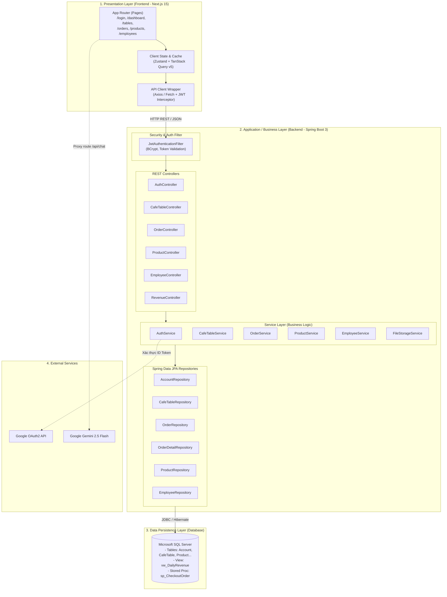

---

### 3.3 Biểu đồ Triển Khai (Deployment Diagram)

Mô tả sự phân bổ phần cứng, giao thức mạng và môi trường thực thi khi hệ thống vận hành thực tế.

```mermaid
deploymentDiagram
flowchart LR
    node_client["🖥️ Client Device
    (PC / POS Terminal / Tablet)
    - Chrome / Edge Browser
    - LocalStorage (Lưu JWT Token)"]

    node_web["☁️ Frontend Hosting Server (Vercel / Node.js)
    - Node.js Runtime (v20+)
    - Next.js Server Side Rendering (SSR)
    - Reverse Proxy API Route (/api/chat)"]

    node_app["⚙️ Backend Server (VPS / Cloud Server)
    - Java Runtime (OpenJDK 17 / 21)
    - Spring Boot Embedded Tomcat (Port 8080)
    - Spring Security & JWT Filter Engine"]

    node_db["🗄️ Database Server
    - Microsoft SQL Server 2022
    - Port: 1433
    - Database: TKQ_Cafe / QLCafe1"]

    node_cloud["🌐 Google Cloud Platform
    - Google Identity Platform (OAuth2)
    - Generative Language API (Gemini Flash)"]

    node_client -- "HTTPS (Port 443)" --> node_web
    node_client -- "HTTPS REST API (Port 8080/443)" --> node_app
    node_web -- "HTTPS (gRPC/REST)" --> node_cloud
    node_app -- "JDBC TCP Connection (Port 1433)" --> node_db
    node_app -- "HTTPS Verification" --> node_cloud
```

---

## 4. Phần II: Biểu Đồ Lớp Thực Thể (Entity Class Diagram / Domain Model)

Biểu đồ này mô hình hóa cấu trúc dữ liệu cốt lõi của dự án, phản ánh chính xác các JPA Entity trong gói `com.qlcafe.backend.entity` và bảng cơ sở dữ liệu `init.sql`.

### 4.1 Cấu Trúc Các Thực Thể & Quan Hệ

1. **Account (Tài khoản)**: Lưu thông tin đăng nhập, mật khẩu mã hóa BCrypt, vai trò (`ADMIN`, `STAFF`).
2. **Employee (Nhân viên)**: Thông tin lý lịch, lương, chức vụ; có quan hệ `1 - 1` với `Account`.
3. **Category (Danh mục)**: Nhóm đồ uống (Cà phê pha máy, Trà trái cây, Bánh ngọt); quan hệ `1 - n` với `Product`.
4. **Product (Sản phẩm)**: Tên món, giá bán, ảnh URL, trạng thái còn/hết hàng (`isAvailable`).
5. **CafeTable (Bàn cà phê)**: Sơ đồ bàn, trạng thái bàn (`AVAILABLE`, `OCCUPIED`, `DELETED`).
6. **Order (Hóa đơn)**: Đại diện cho 1 lần gọi món; liên kết với bàn (nếu ngồi tại chỗ) hoặc `NULL` (nếu mang về - Takeaway), nhân viên tạo đơn, tổng tiền, phương thức thanh toán.
7. **OrderDetail (Chi tiết hóa đơn)**: Thực thể liên kết giữa `Order` và `Product` (quan hệ nhiều - nhiều được chuẩn hóa), lưu số lượng, đơn giá tại thời điểm bán, ghi chú khách yêu cầu.

### 4.2 Mã Biểu Đồ Lớp Thực Thể (Mermaid)

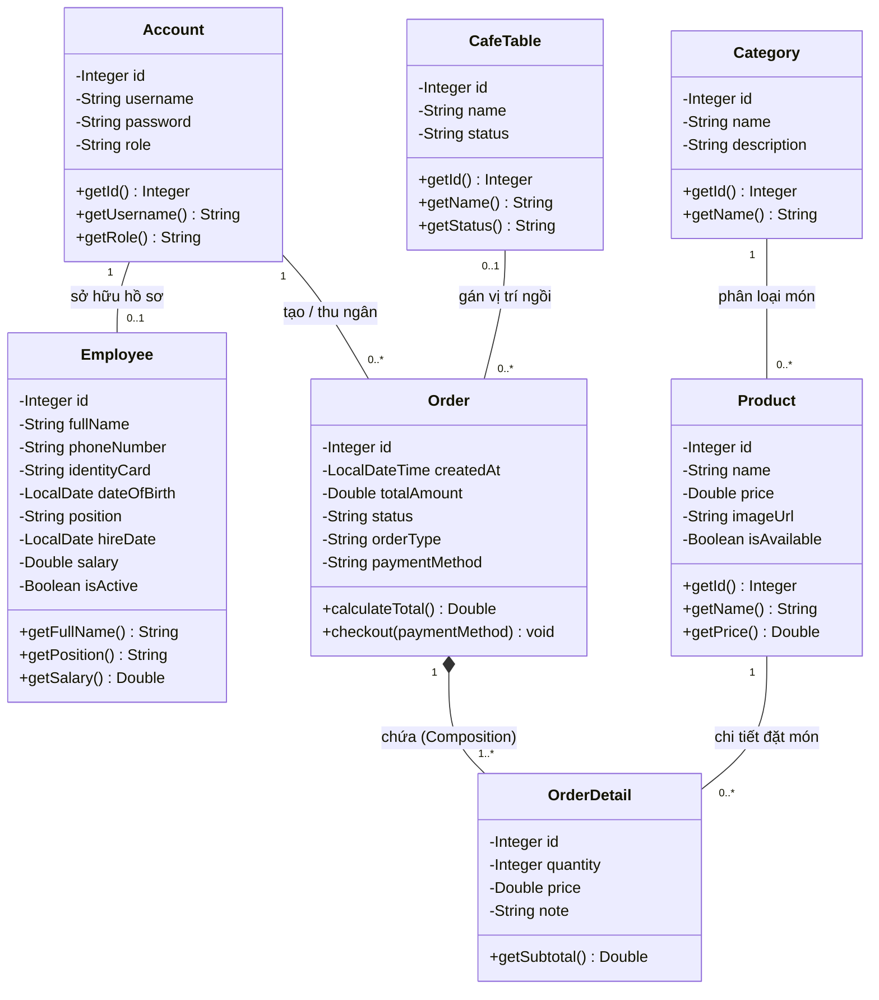

### 4.3 Mã Biểu Đồ Lớp Thực Thể (PlantUML)

Dán đoạn mã dưới đây vào [PlantText](https://www.planttext.com/) hoặc PlantUML để xuất ảnh:

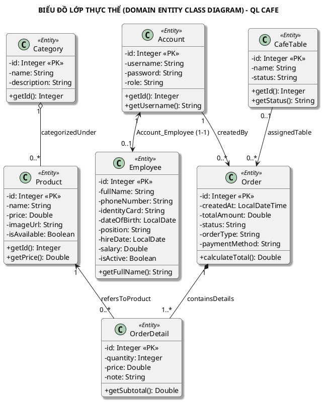

---

## 5. Phần III: Biểu Đồ Của Các Module Chi Tiết Trong Dự Án

### 5.1 Module 1: Xác Thực & Phân Quyền (Authentication & Authorization)

#### Sơ đồ Tuần tự (Sequence Diagram): Đăng nhập tài khoản & Nhận JWT
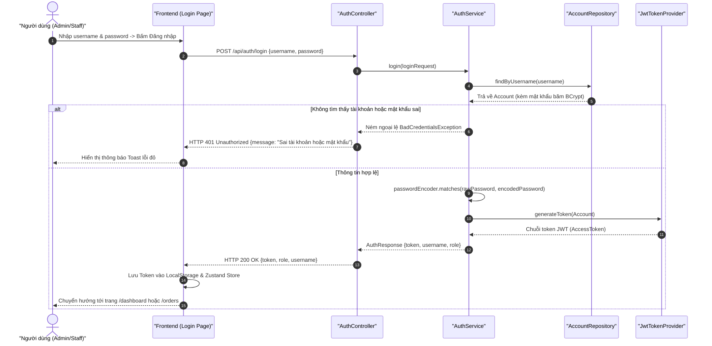

---

### 5.2 Module 2: Bán Hàng & Xử Lý Đơn Hàng POS (Order & POS Module)

Đây là nghiệp vụ cốt lõi nhất của quán cà phê, gồm: Tạo đơn tại bàn, Chuyển bàn, và Thanh toán hóa đơn.

#### Sơ đồ Tuần tự (Sequence Diagram): Tạo đơn hàng tại bàn (POS Order Creation)
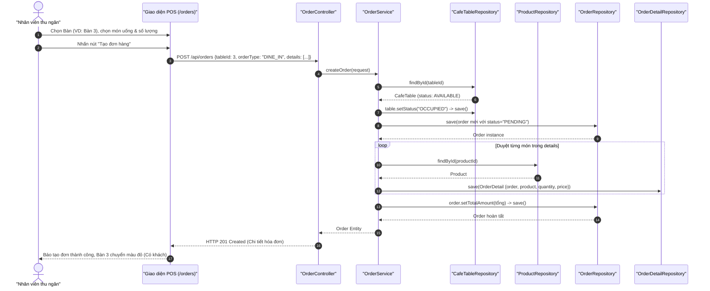

#### Sơ đồ Tuần tự (Sequence Diagram): Thanh toán hóa đơn (Checkout Order)
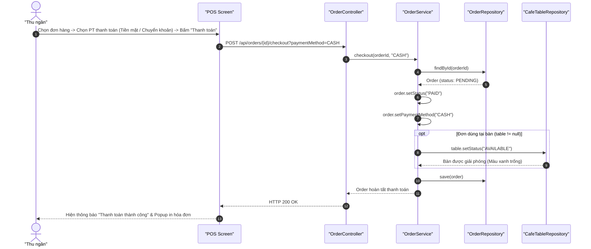

---

### 5.3 Module 3: Quản Lý Sơ Đồ Bàn (Table Management)

#### Biểu đồ Trạng thái của Bàn (State Machine Diagram)
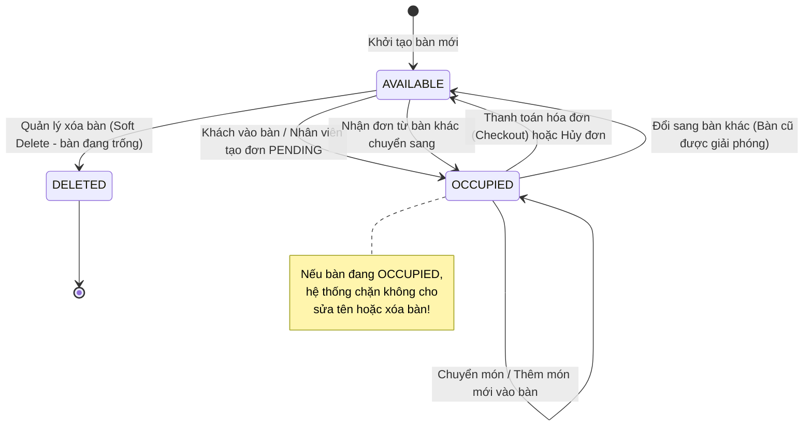

---

### 5.4 Module 4: Quản Lý Menu & Sản Phẩm (Product & Category)

#### Biểu đồ Lớp Thiết Kế Phân Tầng (Design Class Diagram - BCE Pattern)
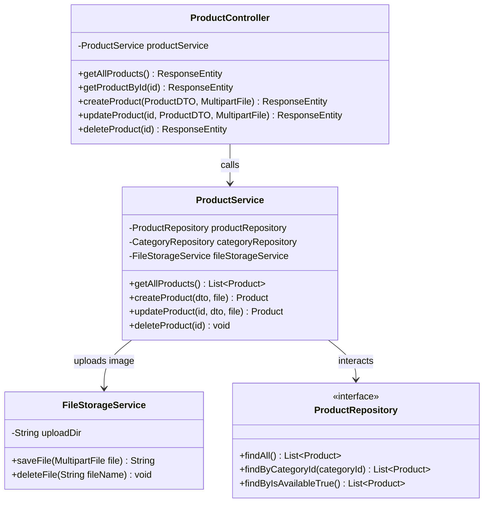

---

### 5.5 Module 5: Quản Lý Nhân Sự (Employee Management)

#### Sơ đồ Tuần tự: Tiếp nhận nhân viên mới (Tạo tài khoản & Hồ sơ)
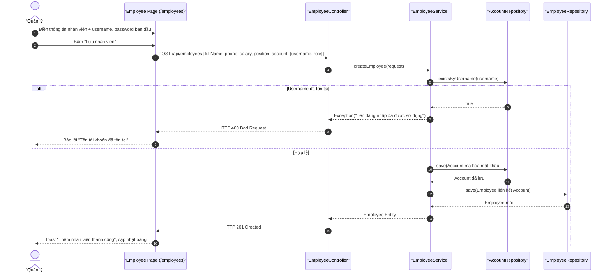

---

### 5.6 Module 6: Thống Kê & Báo Cáo Doanh Thu (Revenue & Analytics)

#### Sơ đồ Tuần tự: Truy vấn Doanh thu theo Mốc thời gian
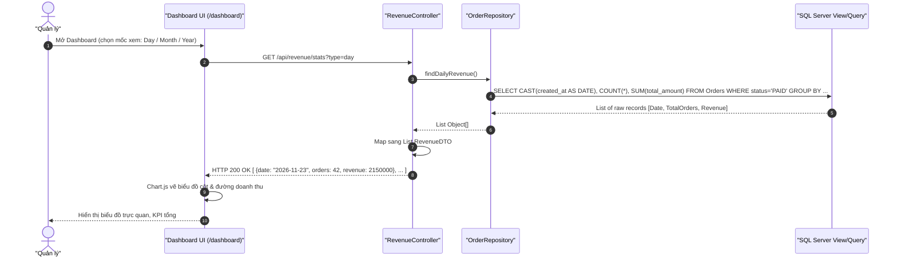

---

### 5.7 Module 7: Trợ Lý Ảo AI Phân Tích Kinh Doanh (Gemini AI Assistant)

Module ứng dụng mô hình ngôn ngữ lớn **Google Gemini 2.5 Flash** để tự động phân tích dữ liệu bán hàng và đề xuất chiến lược kinh doanh cho quản lý quán cà phê.

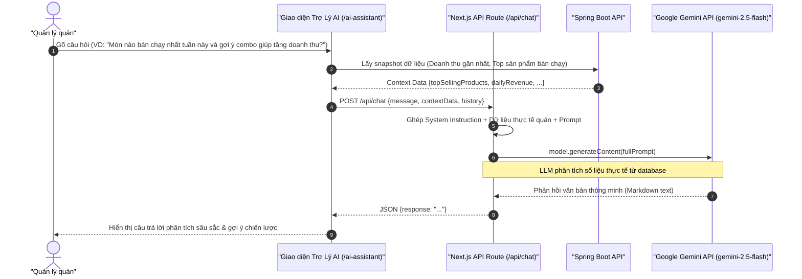

---

## 6. Quy Trình Từng Bước Vẽ & Xuất Ảnh Chèn Vào Báo Cáo

Nếu bạn cần xuất các biểu đồ trên thành file ảnh (.PNG hoặc .SVG) chất lượng cao để chèn vào báo cáo Word hoặc Slide bảo vệ đồ án:

### Bước 1: Chọn công cụ
- **Cách 1 (Nhanh nhất - Không cần cài đặt):**
  1. Sao chép khối mã **Mermaid** trong file này.
  2. Mở trang [Mermaid Live Editor](https://mermaid.live/).
  3. Dán mã vào khung bên trái.
  4. Khung bên phải sẽ hiển thị biểu đồ ngay lập tức -> Nhấn **Actions -> Download PNG / SVG**.

- **Cách 2 (Sử dụng Draw.io để tinh chỉnh vị trí theo ý muốn):**
  1. Mở [Draw.io](https://app.diagrams.net/).
  2. Tạo biểu đồ mới trống.
  3. Vào menu **Arrange** -> **Insert** -> **Advanced** -> Chọn **Mermaid**.
  4. Dán mã Mermaid vào và bấm **Insert**.
  5. Bạn có thể tự do chỉnh màu sắc, font chữ tiếng Việt, kéo các khối cho gọn gàng.
  6. Vào **File** -> **Export as** -> **PNG** (chọn độ phân giải 300 DPI để in ấn sắc nét).

- **Cách 3 (Sử dụng PlantUML):**
  1. Sao chép mã PlantUML (mục 4.3).
  2. Mở [PlantText.com](https://www.planttext.com/).
  3. Dán mã và bấm **Refresh**.
  4. Bấm **Export** để tải ảnh.

### Bước 2: Quy chuẩn trình bày trong báo cáo PTTKHTTT
Khi đưa vào bài báo cáo hoặc đồ án, hãy luôn đặt kèm:
- **Tên hình chuẩn:** `Hình x.y: <Tên biểu đồ>` (Ví dụ: *Hình 3.1: Biểu đồ Use Case tổng thể hệ thống QLCafe*).
- **Mô tả ngắn bên dưới hình:** Liệt kê các tác nhân tham gia và ý nghĩa của các luồng xử lý chính.
