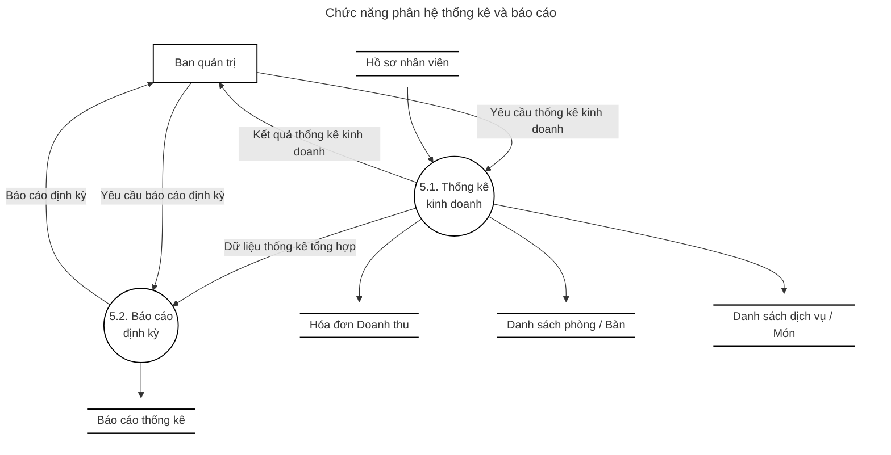
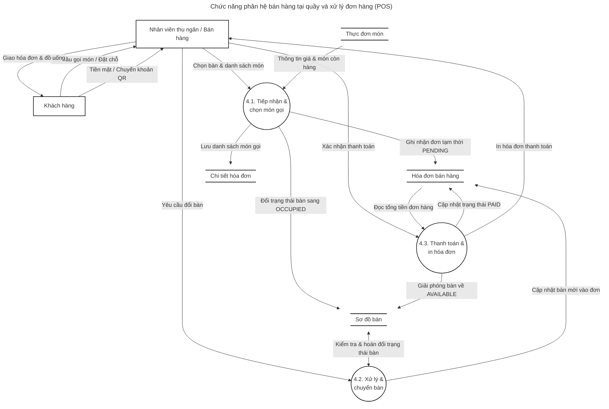
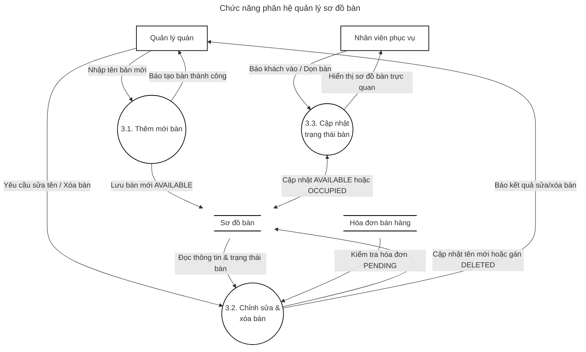
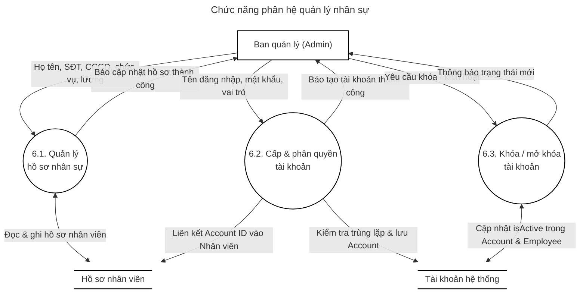

# Sơ Đồ Luồng Dữ Liệu (DFD) Mức Dưới Đỉnh Cho Các Chức Năng Của Hệ Thống Web QLCafe

> **Quy chuẩn môn học:** Phân tích & Thiết kế Hệ thống Thông tin (PTTKHTTT).  
> **Loại sơ đồ:** Data Flow Diagram (DFD) Mức 2 (Mức dưới đỉnh / Phân rã chức năng).  
> **Quy ước chuẩn DFD (DeMarco / Yourdon):**
> - **Hình chữ nhật:** Thực thể ngoài (External Entity).
> - **Hình tròn:** Tiến trình xử lý (Process x.1, x.2...).
> - **2 đường gạch song song (trên và dưới, hở 2 đầu):** Kho dữ liệu (Data Store).
> - **Mũi tên có nhãn:** Luồng dữ liệu (Data Flow).

---

## 1. Chức Năng: Phân Hệ Thống Kê Và Báo Cáo (Khớp 100% ảnh mẫu)

Dán vào **[Mermaid Live Editor](https://mermaid.live/edit)** để xuất ảnh:



---

## 2. Chức Năng: Phân Hệ Bán Hàng Tại Quầy (POS) & Xử Lý Đơn Hàng



---

## 3. Chức Năng: Phân Hệ Quản Lý Sơ Đồ Bàn



---

## 4. Chức Năng: Phân Hệ Quản Lý Menu & Sản Phẩm

```mermaid
---
title: Chức năng phân hệ quản lý thực đơn và sản phẩm
---
flowchart TD
    %% Tác nhân
    Manager["Quản lý quán"]

    %% Tiến trình
    P2_1(("2.1. Quản lý<br/>danh mục món"))
    P2_2(("2.2. Thêm & cập nhật<br/>món uống"))
    P2_3(("2.3. Tải lên &<br/>lưu trữ ảnh món"))

    %% Kho dữ liệu (2 đường song song)
    D_Category["<div style='border-top:2px solid black; border-bottom:2px solid black; padding:4px 14px;'>Danh mục sản phẩm</div>"]
    D_Product["<div style='border-top:2px solid black; border-bottom:2px solid black; padding:4px 14px;'>Thực đơn món</div>"]
    D_Images["<div style='border-top:2px solid black; border-bottom:2px solid black; padding:4px 14px;'>Thư mục hình ảnh</div>"]

    %% Luồng 2.1
    Manager -->|Thêm / Sửa danh mục| P2_1
    P2_1 <-->|Đọc & Lưu danh mục| D_Category
    P2_1 -->|Kết quả danh mục| Manager

    %% Luồng 2.2
    Manager -->|Tên món, giá, danh mục| P2_2
    D_Category -->|Danh mục hợp lệ| P2_2
    P2_2 -->|Lưu thông tin sản phẩm| D_Product
    P2_2 -->|Báo lưu món thành công| Manager

    %% Luồng 2.3
    Manager -->|Tải tệp ảnh món (.jpg/.png)| P2_3
    P2_3 -->|Lưu trữ tệp vật lý| D_Images
    P2_3 -->|Trả về đường dẫn URL ảnh| P2_2

    %% Style
    classDef entity fill:#ffffff,stroke:#000000,stroke-width:1.5px;
    classDef process fill:#ffffff,stroke:#000000,stroke-width:1.5px;
    classDef datastore fill:none,stroke:none;

    class Manager entity;
    class P2_1,P2_2,P2_3 process;
    class D_Category,D_Product,D_Images datastore;
```

---

## 5. Chức Năng: Phân Hệ Quản Lý Nhân Sự


